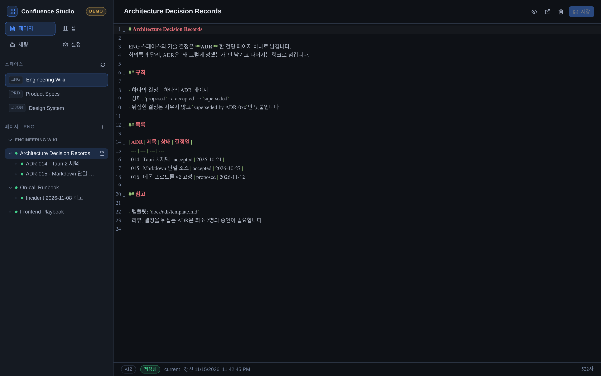
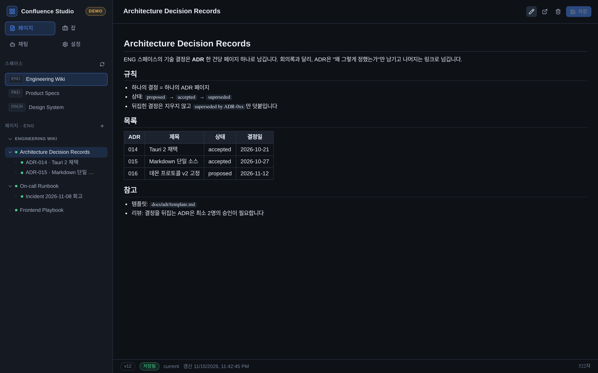
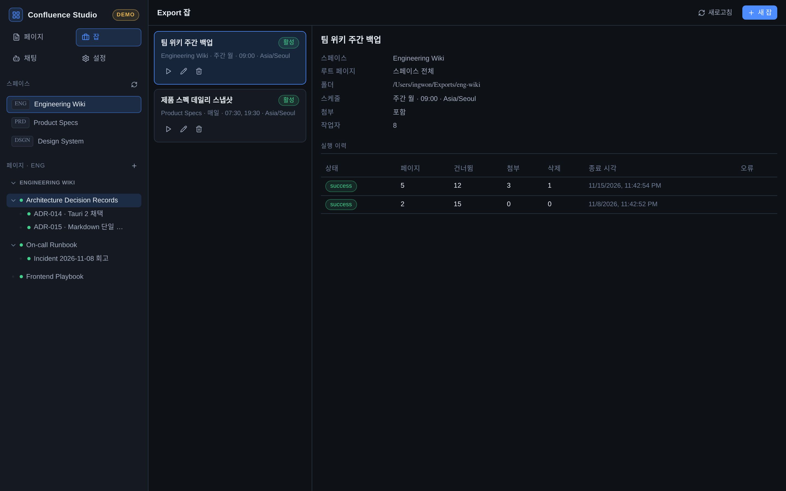
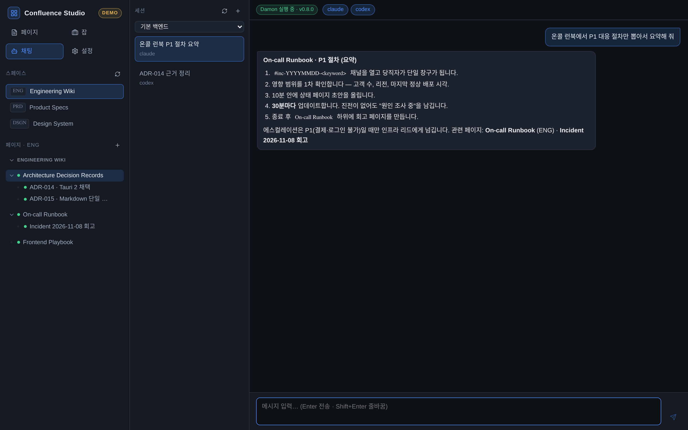
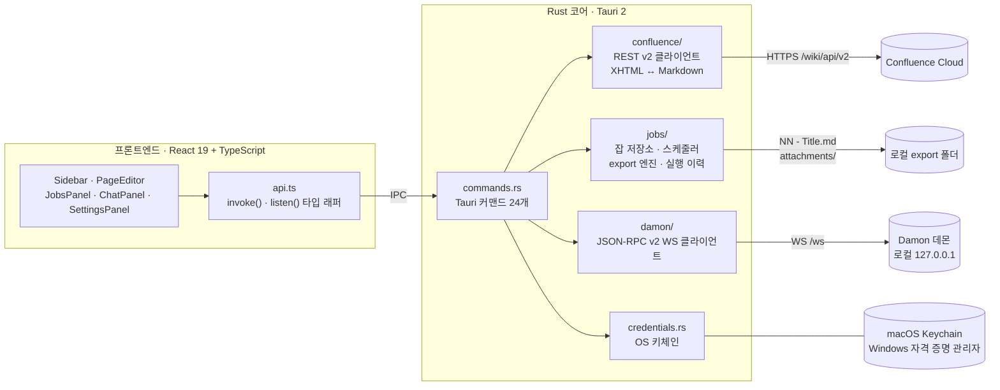
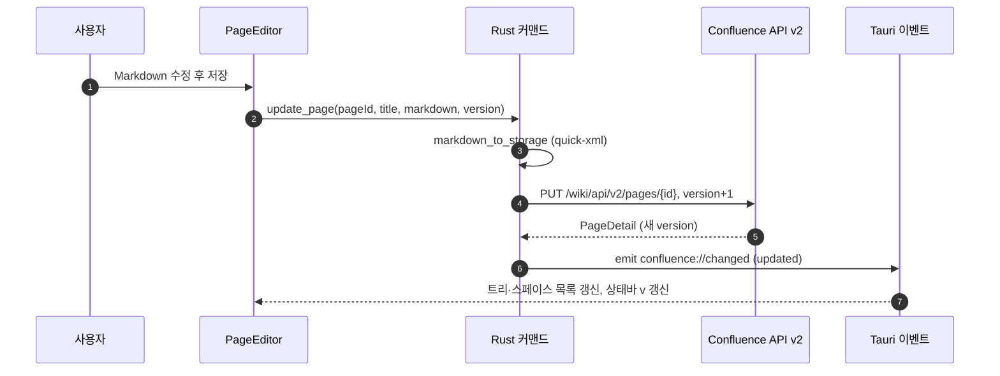

# ⚡ Confluence Studio

<div align="center">


### Confluence Cloud를 **Markdown 손맛**으로 다루는 네이티브 데스크톱 워크스페이스

스페이스 트리 탐색 · Markdown 편집 · 예약 export · 스트리밍 AI 사이드킥 — 창 하나에서.

[](https://react.dev/)
[](https://www.typescriptlang.org/)
[](https://tauri.app/)
[](https://www.rust-lang.org/)
[](https://vite.dev/)

**[▶ 랜딩 페이지](https://developjik.github.io/confluence-studio/)** · **[아키텍처 문서](docs/ARCHITECTURE.md)** · **[스크린샷](#-스크린샷)**

</div>

---



> **한 줄 소개** — 문서 하나 열려고 브라우저 탭을 뒤지던 위키를, 스페이스 트리 · 키보드 중심 Markdown 에디터 · 예약 백업 · AI 채팅이 한 창에 있는 데스크톱 앱으로 옮깁니다. 원본은 Confluence Cloud에 그대로 두고, 로컬에는 읽고 고칠 수 있는 Markdown이 남습니다.

## 😩 문제 → 🙂 해결

| 위키를 쓸 때 흔히 겪는 일 | Confluence Studio |
| :--- | :--- |
| 문서 하나 열려고 탭 10여 개를 오가고, 어느 탭이 최신인지 헷갈린다 | 스페이스/페이지 트리를 앱 안에서 펼치고, 한 창에서 편집·저장한다 |
| 위키 전체를 로컬에서 grep하고 싶은데 매번 수동 export를 돌려야 한다 | 잡(job)으로 저장해 두면 스케줄대로 로컬 Markdown + 첨부 파일을 갱신한다 |
| API 토큰을 설정 파일이나 `.env`에 두게 된다 | 토큰을 macOS Keychain / Windows 자격 증명 관리자에만 저장하고, 웹뷰로 다시 내려보내지 않는다 |
| 문서를 요약·교정하려면 본문을 복사해 다른 AI 창에 붙여야 한다 | Damon 에이전트와 앱 안에서 스트리밍으로 대화하고, 도구 실행 권한은 카드로 직접 승인한다 |

## ✨ 핵심 기능

| 기능 | 실제 동작 | 코드 위치 |
| :--- | :--- | :--- |
| **스페이스·페이지 트리** | Confluence v2 REST로 스페이스 목록과 하위 페이지를 재귀 수집해 트리로 표시. 커서 페이지네이션 처리 | `src-tauri/src/confluence/client.rs` |
| **Markdown 편집** | CodeMirror 6 마크다운 모드 + 구문 강조, 미리보기 토글(react-markdown + GFM), 제목 편집, 저장/삭제, dirty·버전 표시 | `src/components/PageEditor.tsx` |
| **양방향 변환** | 저장 시 Markdown → Confluence storage XHTML, 열 때 반대 방향. `quick-xml` 기반 파서로 제목·문단·리스트·표·코드·인용·이미지·링크를 왕복 | `src-tauri/src/confluence/convert.rs` |
| **예약 export 잡** | 스페이스 전체 또는 특정 페이지 하위를 `NN - Title.md` 구조로 저장. 첨부 파일 포함, 변경 없음(sha256) 건너뛰기, 원격에서 사라진 파일 정리, YAML front matter, 페이지 경로 줄 옵션 | `src-tauri/src/jobs/export.rs` |
| **스케줄러** | 매일 · 하루 여러 번 · 평일 · 주간 · 매월(5종) + IANA 타임존. 30초 tick, 밀린 실행은 건너뛰고, 이미 도는 잡은 중복 실행하지 않음 | `src-tauri/src/jobs/scheduler.rs` |
| **실행 이력·취소** | 실행마다 페이지/건너뜀/첨부/삭제 수와 오류를 `<내보낸 폴더>/.confluence-studio/run_history.json`(최근 100건)에 기록, 진행률 이벤트와 실행 취소 지원 | `src-tauri/src/jobs/history.rs` |
| **OS 키체인 자격증명** | Base URL·이메일·API 토큰을 키체인 항목 3개로 저장. `get_connection`은 토큰을 절대 반환하지 않음 | `src-tauri/src/credentials.rs` |
| **Damon AI 채팅** | `~/.damon/daemon.json`을 힌트로 `/health`를 확인한 뒤 JSON-RPC v2 WebSocket 연결. 세션 생성/선택, 토큰 스트리밍, 추론·도구 이벤트 접기, 권한 요청 카드(허용/항상 허용/거절), 턴 취소 | `src-tauri/src/damon/`, `src/components/ChatPanel.tsx` |
| **변경 반영** | 페이지 생성/수정/삭제 후 `confluence://changed` 이벤트로 스페이스 목록·트리를 다시 읽음 | `src/App.tsx` |

## 📸 스크린샷

아래 화면은 **데모 모드**(샘플 데이터)로 실제 앱 UI를 실행해 캡처했습니다. 실제 Confluence 사이트·Damon 데몬 없이 같은 화면을 띄우는 방법은 [데모 모드](#-데모-모드-confluence-없이-화면만-보기)에 있습니다.

| 편집 · 트리 탐색 | 미리보기 렌더링 |
| :---: | :---: |
|  |  |
| **예약 export 잡과 실행 이력** | **Damon 스트리밍 채팅** |
|  |  |

## 🧱 기술 스택

| 계층 | 사용 기술 | 쓰임 |
| :--- | :--- | :--- |
| UI | React 19, TypeScript 6, Vite 8 | 화면 상태, IPC 바인딩, 번들 |
| 에디터 | CodeMirror 6 (`@uiw/react-codemirror`, `@codemirror/lang-markdown`), react-markdown + remark-gfm | 마크다운 편집·미리보기 |
| 데스크톱 셸 | Tauri 2 (Rust 2024 edition) | 창, IPC 커맨드 24개, 시스템 다이얼로그 |
| HTTP | reqwest (rustls) | Confluence Cloud REST v2 |
| 실시간 | tokio-tungstenite, tokio | Damon JSON-RPC v2 WebSocket, 스케줄러 |
| 변환 | quick-xml | storage XHTML ↔ Markdown |
| 보안 | keyring 3 (apple-native / windows-native) | 자격 증명을 OS 키체인에 보관 |
| 시간 | chrono, chrono-tz | IANA 타임존 스케줄 계산 |
| 테스트 | wiremock, axum(ws) | Confluence REST 목 서버, Damon WS 목 데몬 |

## 🏗 아키텍처



페이지를 고치고 저장할 때의 흐름은 이렇습니다.



export 잡은 같은 변환 파이프라인을 재사용합니다: 트리 수집 → storage를 Markdown으로 변환 → `NN - Title.md`로 저장 → 첨부 다운로드 → `.confluence-studio/state.json`에 sha256 기록(다음 실행에서 변경 없는 페이지 건너뜀) → 사라진 원격 페이지의 로컬 파일 정리 → `run_history.json`에 결과를 남깁니다.

## 🚀 3단계 빠른 시작

**요구사항** — Node.js 20.19+ (Vite 8), pnpm 9+ (lockfile v9), Rust stable + [Tauri 2 사전 준비사항](https://tauri.app/start/prerequisites/). 자격 증명은 OS 키체인에 저장하므로 macOS 또는 Windows에서 실행합니다.

**1. 설치**

```bash
git clone https://github.com/developjik/confluence-studio.git
cd confluence-studio
pnpm install
```

**2. Confluence 연결** — 앱을 한 번 띄우고 `설정`에서 값을 넣습니다.

```bash
pnpm tauri dev
```

- **Base URL**: `https://<사이트>.atlassian.net` (`/wiki`가 붙어 있어도 정규화됩니다)
- **이메일**: Atlassian 계정 이메일
- **API 토큰**: [Atlassian API 토큰 관리](https://id.atlassian.com/manage-profile/security/api-tokens)에서 발급 → `연결 테스트`로 확인

**3. 사용** — 스페이스를 고르고 페이지를 열어 편집하거나, `잡`에서 내보낼 폴더와 스케줄을 지정해 저장합니다. `지금 실행`으로 즉시 돌려볼 수 있습니다.

### 🧪 데모 모드 (Confluence 없이 화면만 보기)

Tauri 런타임·Confluence 사이트·Damon 데몬 없이, 같은 UI를 브라우저에서 샘플 데이터로 띄웁니다.

```bash
pnpm dev:demo   # → http://127.0.0.1:1420
```

`VITE_DEMO=1`일 때 `src/api.ts`가 `src/demo`의 인메모리 백엔드로 바뀝니다. 사이드바에 `DEMO` 배지가 붙고, 어떤 요청도 디스크·Confluence·데몬에 닿지 않습니다. 스크린샷도 이 모드로 캡처했습니다.

## ✅ 빌드와 테스트

```bash
pnpm build                 # tsc 타입 검사 + vite 프로덕션 번들
cd src-tauri && cargo test # Rust 단위 34 + 통합 50 = 84개 (wiremock · axum ws)
```

- 통합 테스트는 실제 네트워크를 쓰지 않습니다: Confluence REST는 `wiremock`, Damon 데몬은 `axum` WebSocket 목이 대신합니다.
- 실 데몬 대상 E2E는 기본적으로 꺼져 있고 `DAMON_LIVE=1`일 때만 돌습니다 (`src-tauri/tests/damon_live.rs`).
- 프론트엔드는 별도 테스트 러너 없이 `tsc` 타입 검사와 빌드로 검증합니다.
- 같은 검사를 CI(`ci` 워크플로)가 자동으로 돌립니다: `tsc --noEmit` + `pnpm build`(ubuntu), `cargo test`(macOS). 활성화 방법은 [docs/ci-setup.md](docs/ci-setup.md).

## 📂 프로젝트 구조

```
confluence-studio/
├── src/                         # 프론트엔드 (React 19 + TypeScript + Vite)
│   ├── App.tsx                  # 뷰 전환, 스페이스/트리/페이지 상태
│   ├── api.ts                   # Tauri invoke/listen 타입 래퍼 (+ 데모 전환)
│   ├── demo/                    # 데모 모드용 인메모리 백엔드 (샘플 데이터)
│   ├── components/              # Sidebar · PageEditor · JobsPanel · ChatPanel · SettingsPanel
│   ├── types.ts                 # Rust DTO의 TS 미러 (camelCase)
│   └── styles.css               # 다크 테마 (CSS 변수 단일 파일)
├── src-tauri/                   # Rust 백엔드 (Tauri 2)
│   ├── src/commands.rs          # IPC 커맨드 24개 + 이벤트 emit
│   ├── src/confluence/          # REST v2 클라이언트, storage ↔ Markdown 변환
│   ├── src/jobs/                # 잡 저장소, 30초 스케줄러, export 엔진, 실행 이력
│   ├── src/damon/               # 데몬 디스커버리, JSON-RPC v2 프로토콜/클라이언트
│   ├── src/credentials.rs       # OS 키체인 연동
│   └── tests/                   # 통합 테스트 (wiremock, axum ws)
└── docs/                        # GitHub Pages 랜딩 + 아키텍처 명세 + 스크린샷
```

## ⚠️ 알려진 한계

- **macOS / Windows만 지원**합니다. `keyring`을 `apple-native`·`windows-native` 기능으로만 빌드해 Linux 키체인 백엔드가 없습니다.
- **동시 작업 수는 아직 쓰이지 않습니다.** 잡 설정에 `maxWorkers`로 저장되지만 export 엔진은 현재 페이지를 순차 처리합니다.
- **첨부 파일은 내려받기만** 합니다. 업로드·편집은 범위 밖입니다.
- **매크로·레이아웃은 손실이 있습니다.** Markdown에 대응이 없는 Confluence 요소는 인용 블록으로 축약되므로, 왕복하면 서식이 단순해질 수 있습니다. 댓글은 다루지 않습니다.
- **대화 내용은 앱이 켜져 있는 동안만** 화면에 남습니다. 세션 목록은 데몬에서 다시 읽지만 과거 메시지 이력 API는 아직 연결하지 않았습니다.
- Damon 채팅은 로컬 Damon 데몬(v0.8 계열, `~/.damon/daemon.json`)이 떠 있어야 동작합니다.

## 📄 상태

- **버전**: v0.1.0 — 개인이 만들고 쓰는 프로젝트입니다. Confluence는 Atlassian의 상표이며, 이 앱은 Atlassian과 무관한 독립 도구입니다.
